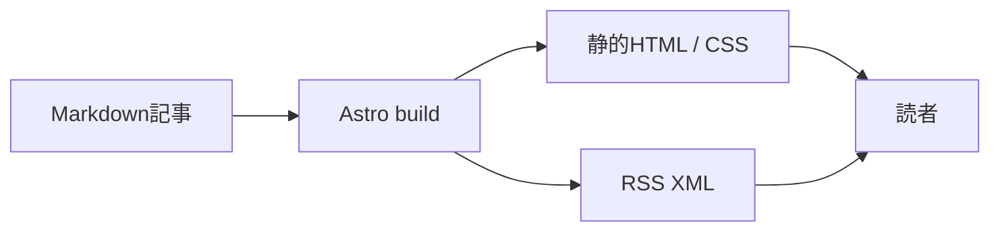

# 技術構成
2026-10-25。既存状態は未追跡のDevbox設定と.envrcのみ。既存.envrcとDevbox lockは保持。

最初の依頼はVoid/D1/R2を含むSSR構成だったが、追加指示で単純なSSGへ変更。Astro 7.4.2のContent CollectionsでMarkdownを読み、静的HTMLとRSSをdistへ出力する。実行時Worker、認証、DB、R2、Cronは不要となり削除。Void 1.2.1を静的公開用CLIとして開発依存に固定し、deploy --helpで--dirを確認。今回の明示許可で本番接続・静的公開を実施。10-deployment.md参照。

記事データはtitle/summary/publishedAt/updatedAt?/draft/sources。Model the Domainの原則に従い、公開判定をpublishedArticlesに集約。下書きは一覧・詳細・RSSに含めない。本文は運営者の信頼済みMarkdownであり、外部の任意HTMLを入力するシステムではない。

キャッシュは公開先の設定に依存し、今回未設定。変更反映には再ビルド・公開が必要。公開した内容は配信済みキャッシュから即時回収できるとは保証しない。

## Kumoの静的レンダリング

指定コンポーネントの採用指示に従い、Kumo 2.15.0のLink/TextをAstroのReact統合でビルド時レンダリングする。ルーティングとMarkdownは引き続きAstroが所有する。Reactでサイト枠全体を再実装する案と比較し、既存Astroテンプレートから公式コンポーネントを直接importする案を採用した。client指示によるhydrationは追加しない。認証・DB・管理画面の追加はない。
